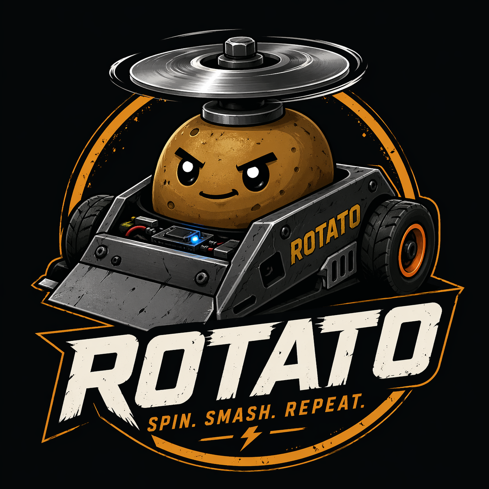

<div align="center">



# Rotato 2027

### Spin. Smash. Repeat.

*A combat-style workshop robot built at [Asmbly](https://asmbly.org) — controlled from your browser, no app required.*

[](https://platformio.org)
[](https://www.espressif.com/en/products/socs/esp32)
[](../LICENSE)

**Author:** Angel Hernandez — [angel@thehomelab.dev](mailto:angel@thehomelab.dev) · [thehomelab.dev](https://www.thehomelab.dev)

🔗 **Project page:** [thehomelab.dev/projects/rotato](https://thehomelab.dev/projects/rotato)

</div>

---

> **AI Assistants (GitHub Copilot, Claude, etc.):** Read [`AI_CONTEXT.md`](AI_CONTEXT.md) instead — it contains the lean technical reference optimized for code generation.

---

## 1. What Is This Robot?

**Rotato** is a small combat-style workshop robot built at Asmbly. It has two drive wheels and an optional weapon motor, all controlled from your phone or laptop through a browser — no app to install.

The brain is an **ESP32 D1 Mini** (ESP32-WROOM-32), a small WiFi + Bluetooth microcontroller board. The two drive wheels are powered directly by an **AT8236** dual H-bridge on the Rotato 2027 board; the weapon uses a standard RC ESC. The firmware (the software running on it) is written in C++ and built with PlatformIO.

---

## 2. How to Connect and Drive

### Step 1 — Power on the robot
Plug in the battery. You'll hear a startup beep (if the buzzer is installed).

### Step 2 — Connect to the robot's WiFi
The robot creates its own WiFi hotspot on boot:

| Setting | Value |
|---------|-------|
| SSID | `Rotato-XXXX` (XXXX = unique 4-char code for your robot) |
| Password | `12345678` |

Connect your phone or laptop to this network.

### Step 3 — Open the web controller
Open a browser and go to: **http://192.168.4.1**

You'll see the robot controller UI with a joystick, weapon button, and status panel.

### Driving with an Xbox controller (optional)
You can drive with an **Xbox Wireless Controller** over Bluetooth. It works with the Series X|S controller, and with the Xbox One controller once its firmware has been updated (2021 or later).

1. Power on the robot.
2. On the controller, hold the small **pair button** on top until the Xbox logo flashes quickly.
3. Wait a few seconds. The robot beeps and the blue LED turns solid when the controller connects.

After the first pairing, just press the **Xbox button** to reconnect.

The robot accepts a *new* controller only in these cases: it has never paired one, it powered on less than 60 s ago, or you pressed **Settings → Bluetooth → Pair controller** in the web UI. This stops a robot from grabbing someone else's controller. **Forget controllers** in the same panel removes all paired controllers.

| Control | Action |
|---------|--------|
| Left stick | Drive (up = forward, sideways = turn) |
| D-pad | Slow drive |
| Hold LB | Precision mode (slower, finer control) |
| RT (right trigger) | Weapon throttle. The weapon spins only while you hold it |
| B | Stop the weapon (release RT to re-enable it) |
| A | Little error sound |

Safety: the weapon ignores RT until you have fully released it once after connecting. If the controller disconnects, the drive motors and weapon stop. You can tune the mapping in `config.h` under "Game Controller".

**Settings → BLE → Nearby Devices → Scan** lists every Bluetooth LE device the robot can hear (put the device in pairing mode first) and says whether Rotato can use it. If a device never appears there, it's classic-Bluetooth-only and can't connect.

**Settings → BLE** also shows what the controller reports about itself: model, serial number, firmware version, battery, signal strength and connection quality, plus a live view of every stick, trigger and button, and the raw data it sends. If the controller disconnects, the panel keeps the last details and shows why it dropped (for example out of range or turned off).

### Connecting to your own WiFi (optional)
Open the Settings panel in the web UI, enter your WiFi network name and password, and save. The robot will reboot and join your network. If it can't connect, it falls back to its own hotspot automatically.

**To reset WiFi credentials:** Hold the BOOT button (small button on the ESP32 board) for 3 seconds after the robot has fully booted.

### Opening the robot by name instead of IP
Once the robot is on your WiFi, open **http://&lt;robot-name&gt;.local**, for example `http://rotato-7c19.local`. The address comes from the robot name: rename the robot "Rotato" (Settings → Identity) and it becomes `http://rotato.local`. The current address is shown at the top of the page and in Settings → WiFi.

- **Several robots on the same network:** give each robot its own name. The default names (Rotato-XXXX, from the chip's MAC address) never clash. If you give two robots the same name, the second one notices the address is taken and keeps its default address instead.
- **Settings → WiFi → Robots on this network** lists every Rotato on the network with an **Open** button.
- Your router's device list shows the robot by the same name.
- `.local` names work on Windows 10+, macOS, iOS and Linux. Some Android browsers don't support them; use the IP address there (it's shown in the same places). On Windows the first visit can take a few seconds to resolve.

---

## 3. Hardware — What's Connected Where

### GPIO Pin Map

| GPIO | D1 Mini pin | Part | What's connected |
|------|-------------|------|-----------------|
| GPIO36 | SVP / A0 | R1/R2 | Battery voltage sensor (ADC) |
| GPIO26 | D0 | U1 AIN1 | Left wheel motor (M2), input 1 |
| GPIO18 | D5 | U1 AIN2 | Left wheel motor (M2), input 2 |
| GPIO19 | D6 | U1 BIN1 | Right wheel motor (M3), input 1 |
| GPIO23 | D7 | U1 BIN2 | Right wheel motor (M3), input 2 |
| GPIO17 | D3 | M4 | Weapon ESC signal (3-pin servo header) |
| GPIO5 | D8 | BZ1 | Buzzer |
| GPIO16 | D4 | D2 | RGB status LED (addressable, not used by firmware yet) |
| GPIO21 | D2 | J3 | I2C SDA (expansion, not used yet) |
| GPIO22 | D1 | J3 | I2C SCL (expansion, not used yet) |
| GPIO0 | — | — | BOOT button on the D1 Mini, if fitted (hold 3s to reset WiFi) |
| GPIO2 | — | — | Blue status LED on the D1 Mini (see below) |

### Status LED (blue LED on the D1 Mini)
The D1 Mini has two LEDs. The **red** one is wired straight to power and is always on. The firmware controls the **blue** one. If several of these apply at once, it shows the one highest in this list:

| What you see | Meaning |
|--------------|---------|
| Very fast strobe | Weapon is spinning |
| Rapid blink (first 2 s after power-on) | Weapon ESC is arming |
| Double blink every second | Battery low (≤15%) or no battery connected |
| Slow blink (on 0.5 s / off 0.5 s) | Waiting to pair a game controller |
| Solid on | Someone is connected (browser, phone app or game controller) |
| Short blip every 2 s | Running normally, nobody connected |

If the LED stays fully on or fully off while nothing is connected, the firmware has frozen. Power-cycle the robot.

### Battery
- Type: **2S or 3S LiPo** (selectable in the web UI; default 3S)
- Safe range: **6.0–8.4V** (2S) or **9.0–12.6V** (3S)
- The battery voltage is measured through a 47K/10K resistor divider on GPIO36. The web UI shows battery % and voltage.
- SW1 (screw switch) or SW2 (wired switch) turns the robot on and off.

### Drive Motors (AT8236 H-bridge)
The left and right wheels are plain DC motors driven by the on-board **AT8236** dual H-bridge. Each motor has two control inputs; the firmware drives them with **20 kHz PWM** (above human hearing, so the motors don't whine).

| IN1 | IN2 | Motor |
|-----|-----|-------|
| 0 | 0 | Coast |
| 1 | 0 | Forward |
| 0 | 1 | Reverse |
| 1 | 1 | Brake |

By default the firmware uses *slow decay* (`DRIVE_SLOW_DECAY true`): one input stays high while the other is pulsed, which gives smoother low-speed control and brakes when the stick is centered.

### Weapon (ESC Signal)
The weapon uses a standard RC ESC on the 3-pin header M4: **50 Hz, pulse width 1000 µs (off) to 2000 µs (full speed)**.

### Buzzer
A passive buzzer on GPIO5. Produces startup, weapon-on, weapon-off, and error tones.

### No safety switch
The Rotato 2027 board has no weapon kill-switch input, so `HAS_SAFETY_SWITCH` is disabled in `config.h`. Use the power switch to cut everything.

---

## 4. The Weapon Motor — Important Notes

The weapon ESC (motor speed controller) needs special handling:

1. **On power-on, the weapon is locked for 2 seconds.** The firmware holds the signal at minimum throttle (1000 µs) to arm the ESC. The weapon button in the UI is disabled until this completes.

2. **ESC full-range calibration** teaches the ESC what your signal range is. Trigger it from the Settings panel in the web UI. **Always disconnect the weapon motor (unplug the motor wires) before running calibration.** The ESC will beep to confirm each step.

---

## 5. Building and Flashing the Firmware

### What You Need
- [VS Code](https://code.visualstudio.com/) with the [PlatformIO extension](https://platformio.org/install/ide?install=vscode)
- A USB cable connected to the ESP32 D1 Mini (on Windows you may need the CH340 or CP210x USB driver)

### First-time Flash (important order!)

```bash
# 1. Upload the web UI to the robot's filesystem first
pio run --target uploadfs

# 2. Then flash the firmware
pio run --target upload
```

After that, for firmware-only changes you only need:
```bash
pio run --target upload
```

### Updating over WiFi (no cable)
Once the robot has firmware on it and is on your network, you can update it wirelessly:

```bash
pio run -e d1_mini32_ota --target upload
```

In VS Code, use the PlatformIO sidebar: **Project Tasks → d1_mini32_ota → Upload**. Before that, set `upload_port` in the `[env:d1_mini32_ota]` section of `platformio.ini` to your robot's IP address. The IP is printed on the serial monitor at boot. To update a different robot one time, add `--upload-port <ip>`. When your computer is joined to the robot's own hotspot, the IP is `192.168.4.1`.

The upload takes about 30 seconds. The robot reboots on its own, and the tool checks that it comes back running the build you just compiled. A brand-new board still needs its first flash over USB.

### Other Useful Commands

```bash
# Build without flashing (check for errors)
pio run

# Open the serial monitor to see debug output
pio device monitor
```

### Viewing Debug Output
The robot prints detailed information over USB Serial at **115200 baud**. Open the serial monitor right after powering on to see the boot sequence, IP address, and any errors.

---

## 6. The One File You Need to Edit: `src/config.h`

Almost all hardware customization lives in a single file: **`src/config.h`**. It is heavily commented. Here are the most common things to change:

### Motor spins the wrong way
```cpp
#define MOTOR_LEFT_REVERSED   false   // change to true
#define MOTOR_RIGHT_REVERSED  true    // change to false
```

### Change the robot's default WiFi name or password
```cpp
#define AP_SSID_PREFIX  "Rotato-"   // your robot will be "Rotato-XXXX"
#define AP_PASSWORD     "12345678"  // must be 8+ characters
```

### Disable the buzzer (if BZ1 is not fitted)
```cpp
// Comment out this line:
// #define HAS_BUZZER
```

### Limit drive motor power (e.g. 6V motors on a 3S battery)
```cpp
#define DRIVE_MAX_POWER  100  // % of full power at full stick; try 50 for 6V motors on 3S
```
For a gentler robot (beginners), use the **Speed Limit** slider in the web UI instead.

### Change how the drive motors stop
```cpp
#define DRIVE_SLOW_DECAY  true   // true = brake when stick is centered; false = coast
```

---

## 7. Files You Should Know About

| File | What it does | Should you edit it? |
|------|-------------|---------------------|
| `src/config.h` | All hardware settings | ✅ Yes — start here |
| `src/version.h` | Firmware `MAJOR` and fallback PCB revision. Version shown is `MAJOR.BUILD` (2.0, 2.1, …); the PCB revision comes from the KiCad board's title block when `Electronics/` is present | ✅ Yes — bump MAJOR for big releases |
| `src/main.cpp` | Wires everything together | ✅ Yes — for new features |
| `src/hardware/*.h/.cpp` | Motor, buzzer, battery, safety, status LED drivers | ✅ Yes |
| `src/connectivity/*.h/.cpp` | WiFi, web server, BLE, game controller | ✅ Yes |
| `data/index.html` | The web UI running in your browser | ✅ Yes |
| `src/version_build.h` | Auto-generated — build timestamp | ❌ No |
| `src/web_ui_html.h` | Auto-generated — embedded web UI | ❌ No |
| `build_number.txt` | Last build made, as `MAJOR.BUILD` (empty = next build is `MAJOR.0`; restarts at 0 when MAJOR changes) | ❌ No |
| `scripts/*.py` | Build pipeline scripts (incl. `ota_upload.py` for WiFi updates) | ⚠️ Advanced only |

---

## 8. Common Tasks Step by Step

### Give your robot a custom name
Web UI → Settings → Robot Name → type a name → Save. The robot reboots and uses the new name as its WiFi SSID.

### Calibrate the battery reading
If the battery percentage looks wrong, go to the web UI Settings → Battery Calibration. Adjust the ratio until the displayed voltage matches a multimeter reading.

### Add a new sound effect
1. Open `src/hardware/BuzzerController.cpp`
2. Define a new sequence array: `static const BeepStep mySound[] = {{800,100},{0,50},{1200,200}};`
3. Add `void beepMyEvent() { playSequence(mySound, 3); }` to the class
4. Declare it in `BuzzerController.h`
5. Call `buzzer.beepMyEvent()` from `main.cpp`

### Add a new button/control to the web UI
1. Add the HTML/JS to `data/index.html`
2. Send a new JSON message over WebSocket, e.g. `{"type":"myCommand","value":42}`
3. Add a callback type and `onMyCommand()` registration method in `WebServerManager.h`
4. Parse the new type in `WebServerManager.cpp`
5. Register and handle the callback in `main.cpp`

---

> **AI Assistants:** See [`AI_CONTEXT.md`](AI_CONTEXT.md) for the technical reference optimized for code generation.

---

## License

Copyright (c) 2026 **Angel Hernandez** — [www.thehomelab.dev](https://www.thehomelab.dev)

This project is released under a **Non-Commercial Source-Available License**. You are free to use, study, modify, and share it for non-commercial purposes, subject to these rules:

- **Attribution required** — Any project (code, firmware, article, video, workshop, or AI-generated output) that uses or is derived from this software must credit: `Angel Hernandez — www.thehomelab.dev`. This applies even if you only used `AI_CONTEXT.md` as a prompt.
- **No commercial use** — You may not sell, license, or use this software (or derivatives) to generate revenue without explicit written permission from the author.
- **Share-alike** — Derivatives must carry the same license.

See [LICENSE](../LICENSE) for the full legal text. For commercial licensing: [angel@thehomelab.dev](mailto:angel@thehomelab.dev)

